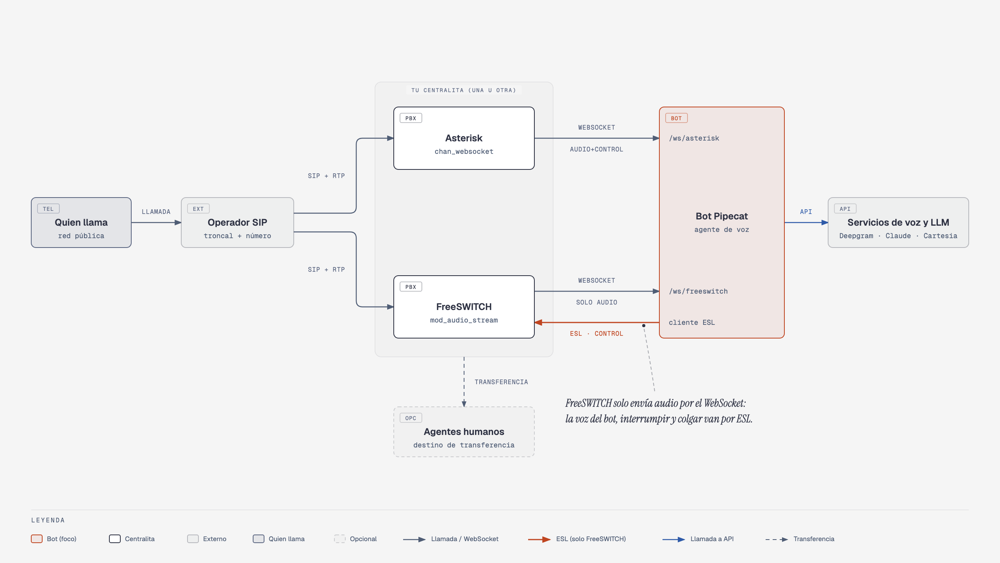

# 3. Troncales SIP

Los dialplans incluidos solo atienden a softphones registrados. Para que el agente conteste un
número real hace falta un **troncal SIP**: la conexión entre tu centralita y un operador que
tiene acceso a la red telefónica.



> Esta guía **no está probada en este repositorio contra un operador real**. Las configuraciones
> son el punto de partida habitual; cada operador publica su guía con los valores exactos
> (dominio, IPs, códecs, formato de los números).

## Lo que te da el operador

Al contratar un troncal recibes:

- **Uno o más números (DID)**, por los que entran las llamadas.
- **Un servidor SIP** (`sip.operador.example`).
- **Una forma de autenticarte**, una de dos:

| Modo | Cómo funciona | Cuándo se usa |
| --- | --- | --- |
| **Registro** | Tu centralita se registra con usuario y contraseña, como un teléfono. El operador envía las llamadas a donde te registraste | IP dinámica o tras NAT |
| **Por IP** | El operador acepta y envía tráfico solo a tu IP pública fija. Tú aceptas tráfico solo de las suyas | Producción con IP fija |

## Antes de tocar la centralita

1. **IP pública.** Pon en `.env` `EXTERNAL_IP=<tu IP pública>`: es la que la centralita anuncia
   para la señalización y el audio. Con Docker en Linux, usa `network_mode: host`.
2. **Cortafuegos.** Abre el puerto SIP y el rango RTP **solo a las IPs del operador**. Un puerto
   SIP abierto a Internet recibe intentos de fraude en minutos.
3. **Códecs.** Acuerda G.711 (PCMU o PCMA); es lo que este proyecto espera.
4. **Formato de los números.** Pregunta cómo llega el número marcado (`+573001234567`,
   `573001234567`, `3001234567`): el dialplan tiene que coincidir exactamente.

## Asterisk

**1. Carga el módulo de registro** (solo en modo registro) en `asterisk/conf/modules.conf`:

```ini
load = res_pjsip_outbound_registration.so
```

**2. Define el troncal** en `asterisk/conf/pjsip.conf`:

```ini
; --- Troncal con el operador ---------------------------------------------------------------

[operador-auth]
type = auth
auth_type = userpass
username = MI_USUARIO
password = MI_CONTRASEÑA

[operador-aor]
type = aor
contact = sip:sip.operador.example

[operador]
type = endpoint
transport = transport-udp
context = from-trunk            ; las llamadas entrantes caen en este contexto
disallow = all
allow = ulaw,alaw
outbound_auth = operador-auth
aors = operador-aor
from_user = MI_USUARIO
from_domain = sip.operador.example
direct_media = no
rtp_symmetric = yes
force_rport = yes
rewrite_contact = yes

; Reconoce como "operador" lo que venga de sus IPs.
[operador-identify]
type = identify
endpoint = operador
match = 203.0.113.10

; Solo en modo registro.
[operador-registro]
type = registration
transport = transport-udp
outbound_auth = operador-auth
server_uri = sip:sip.operador.example
client_uri = sip:MI_USUARIO@sip.operador.example
contact_user = MI_DID
retry_interval = 60
```

Si pones la contraseña como `${VARIABLE}`, añádela a la lista `PLACEHOLDERS` de
`asterisk/docker-entrypoint.sh` y al servicio en `compose.yaml`.

**3. Enruta el DID al agente** en `asterisk/conf/extensions.conf`:

```ini
[from-trunk]
; El número tal como lo envía el operador.
exten = +573001234567,1,NoOp(Llamada entrante de ${CALLERID(num)})
 same = n,Dial(WebSocket/voice_agent/c(slin)f(json)v(caller=${URIENCODE(${CALLERID(num)})}))
 same = n,Hangup()
```

**4. Comprueba.**

```bash
docker compose restart asterisk
docker compose exec asterisk asterisk -rx "pjsip show registrations"   # debe decir Registered
docker compose exec asterisk asterisk -rx "pjsip show endpoint operador"
```

**Llamadas salientes** (para transferir a un número externo o para campañas):

```ini
same = n,Dial(PJSIP/${EXTEN}@operador,30)
```

## FreeSWITCH

En FreeSWITCH un troncal es un **gateway** dentro de un perfil SIP. Lo convencional es separar
teléfonos y operadores en dos perfiles: `internal` (pide contraseña) y `external` (sin
contraseña, pero limitado por IP).

**1. Lista de acceso** con las IPs del operador, en
`freeswitch/conf/autoload_configs/acl.conf.xml`:

```xml
<list name="operadores" default="deny">
  <node type="allow" cidr="203.0.113.10/32"/>
</list>
```

**2. Perfil `external` con el gateway**, en un archivo nuevo
`freeswitch/conf/sip_profiles/external.xml`:

```xml
<profile name="external">
  <gateways>
    <gateway name="operador">
      <param name="proxy" value="sip.operador.example"/>
      <param name="username" value="MI_USUARIO"/>
      <param name="password" value="MI_CONTRASEÑA"/>
      <!-- false en modo por IP -->
      <param name="register" value="true"/>
    </gateway>
  </gateways>
  <settings>
    <param name="sip-ip" value="$${local_ip_v4}"/>
    <param name="rtp-ip" value="$${local_ip_v4}"/>
    <param name="ext-sip-ip" value="$${external_ip}"/>
    <param name="ext-rtp-ip" value="$${external_ip}"/>
    <param name="rtp-timer-name" value="soft"/>
    <param name="sip-port" value="5090"/>
    <param name="dialplan" value="XML"/>
    <!-- Las llamadas entrantes caen en este contexto -->
    <param name="context" value="public"/>
    <!-- Sin contraseña: solo se acepta lo que venga de las IPs del operador -->
    <param name="auth-calls" value="false"/>
    <param name="apply-inbound-acl" value="operadores"/>
    <param name="inbound-codec-prefs" value="$${global_codec_prefs}"/>
    <param name="outbound-codec-prefs" value="$${global_codec_prefs}"/>
  </settings>
</profile>
```

Publica el puerto nuevo (`5090/udp`) en `compose.yaml`. `rtp-timer-name=soft` es obligatorio en
cualquier perfil cuyas llamadas vayan al bot: sin él, el audio del bot no se reproduce al ritmo
correcto.

**3. Enruta el DID al agente** en un archivo nuevo `freeswitch/conf/dialplan/public.xml`:

```xml
<include>
  <context name="public">
    <extension name="did_agente">
      <!-- El número tal como lo envía el operador -->
      <condition field="destination_number" expression="^\+?573001234567$">
        <action application="answer"/>
        <action application="set" data='STREAM_EXTRA_HEADERS={"Authorization":"Bearer $${bot_token}"}'/>
        <action application="set" data="STREAM_HEART_BEAT=$${stream_heart_beat}"/>
        <action application="set" data="r=${uuid_audio_stream(${uuid} start $${bot_ws_url} mono 8k ${uuid})}"/>
        <action application="park"/>
      </condition>
    </extension>
  </context>
</include>
```

**4. Comprueba.**

```bash
docker compose restart freeswitch
docker compose exec freeswitch sh -c 'fs_cli -p "$FREESWITCH_ESL_PASSWORD" -x "sofia status"'
# el gateway debe aparecer como REGED (modo registro) o NOREG (modo por IP)
```

**Llamadas salientes:**

```xml
<action application="bridge" data="sofia/gateway/operador/${destination_number}"/>
```

## Si algo falla

| Síntoma | Causa habitual |
| --- | --- |
| El troncal no registra | Usuario, contraseña o dominio; el cortafuegos bloquea la respuesta |
| La llamada no entra y el operador da tono de ocupado | El número no coincide con el dialplan; mira el número exacto en el registro de la centralita |
| Entra, pero no se oye nada o solo en un sentido | `EXTERNAL_IP` incorrecta o el rango RTP cerrado en el cortafuegos |
| Se oye, pero el agente no contesta | El bot no está arriba o la credencial no coincide; mira `docker compose logs bot` |
| Se corta a los 30 segundos | El `ACK` no llega: casi siempre NAT en la señalización |

Para ver la señalización:

```bash
docker compose exec asterisk asterisk -rx "pjsip set logger on"
docker compose exec freeswitch sh -c 'fs_cli -p "$FREESWITCH_ESL_PASSWORD" -x "sofia global siptrace on"'
```
