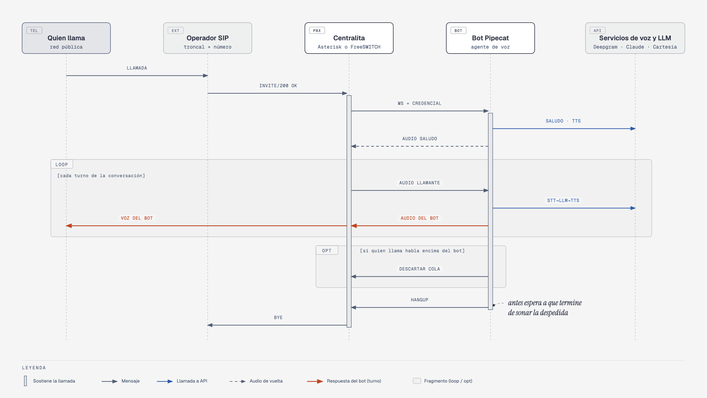

# 6. Un agente en producción

Tener el agente funcionando en tu máquina es la parte fácil. Operarlo significa tener definidos
cinco flujos: el de una llamada, el de los fallos, el de despliegue, el de cambios al agente y el
de observación. Esta guía los describe y dice, en cada uno, qué hay ya en el repositorio y qué
falta.

## 1. El flujo de una llamada



| Fase | Qué ocurre | Dónde |
| --- | --- | --- |
| **Entrada** | El operador entrega la llamada por el troncal; el dialplan la dirige al agente | Centralita |
| **Conexión** | La centralita abre un WebSocket al bot con su credencial. El bot la valida *antes* de aceptar | `src/telephony/auth.py` |
| **Arranque** | El adaptador lee el primer mensaje (qué llamada es y con qué audio) y crea el pipeline | `src/telephony/*` |
| **Saludo** | El bot habla primero: quien llama no debe oír silencio | `src/agent/pipeline.py` |
| **Turnos** | Audio → texto → LLM → voz, una y otra vez. Las teclas llegan como texto | Pipeline |
| **Interrupción** | Si la persona habla encima, se corta la respuesta y se vacía el audio en cola | Serializer de cada centralita |
| **Cierre** | Cuelga la persona (se cierra el WebSocket) o cuelga el agente (`end_call`), esperando a que termine de sonar la despedida | `src/agent/tools.py` |

Una llamada no comparte estado con otras: todo lo que necesita vive en su conexión.

## 2. El flujo de fallos

Lo que distingue un piloto de un servicio es qué oye quien llama cuando algo se rompe.

| Qué falla | Qué pasa hoy | Qué conviene en producción |
| --- | --- | --- |
| **El bot no responde** o rechaza la credencial | Asterisk reintenta (3 veces) y el dialplan sigue: cuelga. FreeSWITCH cuelga con el script `audio_stream_hangup.lua` | Desviar a una cola o a un buzón en vez de colgar |
| **El bot se cae en mitad de la llamada** | La centralita detecta el WebSocket cerrado y cuelga (*comprobado en ambas*) | Lo mismo: desviar a una persona |
| **Un proveedor falla** (STT, LLM o TTS) | El error queda en el registro y **la llamada sigue abierta, en silencio** (*comprobado con claves inválidas*) | Detectar el error y terminar con un mensaje grabado o transferir. Es la mejora pendiente más importante |
| **Un proveedor va lento** | Pausas largas | Tiempo máximo por respuesta y una frase de espera; un segundo proveedor de respaldo |
| **Quien llama no dice nada** | Pipecat cancela el pipeline por inactividad (`idle_timeout_secs`) | Preguntar "¿sigue ahí?" antes y colgar con despedida |
| **La llamada no termina nunca** | Nada la limita | Duración máxima en el dialplan |
| **Se alcanza un límite de concurrencia** del proveedor | Esa llamada falla como "proveedor falla" | Limitar las llamadas simultáneas en la centralita por debajo del límite |

Cómo desviar cuando el bot no está, en cada centralita:

```ini
; Asterisk: si Dial al bot falla, DIALSTATUS no es ANSWER
 same = n,Dial(WebSocket/voice_agent/c(slin)f(json))
 same = n,GotoIf($["${DIALSTATUS}" != "ANSWER"]?respaldo,s,1)
```

```lua
-- FreeSWITCH: en freeswitch/conf/scripts/audio_stream_hangup.lua, en lugar de uuid_kill
freeswitch.API():executeString("uuid_transfer " .. uuid .. " 2002 XML default")
```

Duración máxima de una llamada:

```ini
; Asterisk, antes del Dial
 same = n,Set(TIMEOUT(absolute)=900)
```

```xml
<!-- FreeSWITCH, antes de uuid_audio_stream -->
<action application="sched_hangup" data="+900 allotted_timeout"/>
```

Para un proveedor de respaldo, Pipecat tiene conmutadores de servicio (`ServiceSwitcher`,
`LLMSwitcher`) que permiten tener dos servicios en el pipeline y cambiar de uno a otro.

## 3. El flujo de despliegue

```
cambio ─▶ pruebas ─▶ imagen ─▶ ensayo ─▶ réplicas nuevas ─▶ vaciar las viejas ─▶ retirar
```

1. **Pruebas** en cada cambio: `uv run pytest` y `uv run ruff check .`.
2. **Imagen** del bot con las dependencias fijadas (`uv.lock`). Las centralitas también están
   fijadas: `ASTERISK_VERSION` y `MAS_REF`/`FS_VERSION` en sus Dockerfile.
3. **Ensayo** contra un entorno con centralita propia. Como mínimo, la llamada sin teléfono del
   README; mejor, un número de pruebas en el troncal.
4. **Réplicas nuevas** al lado de las viejas (`docker compose up -d --scale bot=N` o tu
   orquestador).
5. **Vaciar antes de retirar.** Parar una réplica corta sus llamadas en curso. Deja de enviarle
   llamadas nuevas, espera a que terminen las que tiene (dale un plazo mayor que tu duración
   máxima de llamada) y entonces retírala.
6. **Vuelta atrás**: conserva la imagen anterior y vuelve a ella con el mismo procedimiento.

**Secretos.** `.env` sirve en una máquina. En producción, las claves de API y las credenciales
de la centralita van en el gestor de secretos de tu plataforma. Rota `BOT_TOKEN` y la contraseña
del event socket como cualquier otra credencial: cambiarlas exige reiniciar la centralita y el
bot a la vez.

**La centralita se cambia aparte.** Reiniciar Asterisk o FreeSWITCH corta todas las llamadas,
con o sin agente. Hazlo en ventana y, para dialplan, recarga sin reiniciar
(`dialplan reload` / `reloadxml`).

## 4. El flujo de cambios al agente

El prompt y las herramientas cambian mucho más que el código, y un cambio de una línea puede
romper una conversación. Trátalos como código:

1. **El prompt está versionado** (`prompts/agent.md`): cada cambio pasa por revisión.
2. **Conjunto de casos**: una lista de conversaciones que deben seguir funcionando (agenda una
   cita, pide algo fuera de alcance, interrumpe, no dice nada, pide una persona). Pipecat incluye
   un ejecutor (`pipecat eval`) que simula a quien llama y juzga el resultado.
3. **Prueba con voz real** antes de publicar: lo que se lee bien no siempre suena bien.
4. **Despliegue gradual**: primero una parte de las llamadas (una extensión o un DID de prueba),
   después todas.
5. **Cambiar de modelo es un cambio de prompt**: repite los casos.

## 5. El flujo de observación

**Registro.** El nivel por defecto (`DEBUG`) escribe el prompt y cada transcripción. En
producción usa `LOGURU_LEVEL=INFO` (*comprobado*): deja una línea por inicio y fin de llamada con
su identificador, y los errores. Ese identificador es el del canal en la centralita, así que
sirve para cruzar los dos registros.

**Qué medir.**

| Métrica | Por qué |
| --- | --- |
| Llamadas simultáneas, por réplica | Capacidad y reparto |
| Tiempo hasta la primera palabra del bot | Si es largo, cuelgan antes del saludo |
| Latencia por turno, separada en STT, LLM y TTS | Saber qué pieza es la lenta |
| Errores por proveedor | Detectar una caída antes que los usuarios |
| Duración y quién colgó | Colgar en los primeros segundos suele ser un problema de audio o de saludo |
| Porcentaje de transferencias | Mide lo que el agente no resuelve |
| Coste por llamada | Minutos de STT y TTS, tokens del LLM |

Pipecat mide latencias y consumo si se activa en el pipeline
(`PipelineParams(enable_metrics=True, enable_usage_metrics=True)` en `src/agent/pipeline.py`);
hoy no está activado.

**Salud.** El bot expone `GET /health` y las tres imágenes tienen comprobación de salud en
`compose.yaml`. Añade una prueba de extremo a extremo periódica: una llamada sintética que
compruebe que el agente saluda. Es la única que detecta "todo está arriba pero no se oye".

**Alertas** que merecen despertar a alguien: errores de un proveedor por encima de un umbral,
ninguna llamada en horario en que debería haberlas, y la llamada sintética fallando.

## 6. Seguridad

- [ ] `wss://` o red privada entre la centralita y el bot.
- [ ] El puerto del bot (8765) no es alcanzable desde Internet.
- [ ] El event socket de FreeSWITCH (8021) solo es alcanzable por el bot.
- [ ] SIP y RTP abiertos solo a las IPs del operador y de tus sedes.
- [ ] Contraseñas SIP largas y únicas; las cuentas de prueba (`1000`, `1001`) eliminadas.
- [ ] Las herramientas no aceptan números ni destinos libres del LLM
      ([guía 5](05-transferencias.md)).
- [ ] Registro en `INFO` y política de retención para transcripciones y grabaciones
      ([guía 7](07-casos-avanzados.md)).
- [ ] Aviso de que se habla con un asistente automático y de grabación, según la normativa
      aplicable.

## 7. Lista antes de salir

- [ ] Troncal probado con llamadas reales entrantes ([guía 3](03-troncales-sip.md)).
- [ ] Voz nativa del idioma elegida y nivel de audio comprobado en un teléfono real.
- [ ] Interrupción probada desde un móvil con manos libres (el peor caso de eco).
- [ ] Desvío definido para cuando el bot no responde.
- [ ] Manejo del fallo de proveedor: la llamada no se queda en silencio.
- [ ] Duración máxima de llamada.
- [ ] Límites de concurrencia de cada proveedor conocidos y por encima del pico esperado.
- [ ] Rango RTP dimensionado (dos puertos por llamada).
- [ ] Procedimiento de vaciado y de vuelta atrás ensayado.
- [ ] Métricas, alertas y llamada sintética funcionando.
